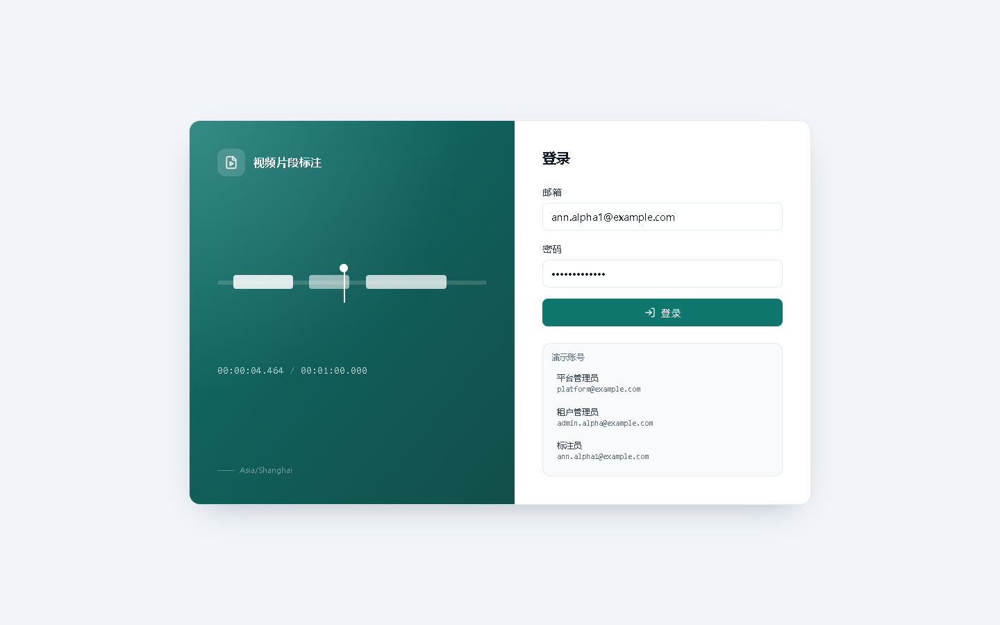
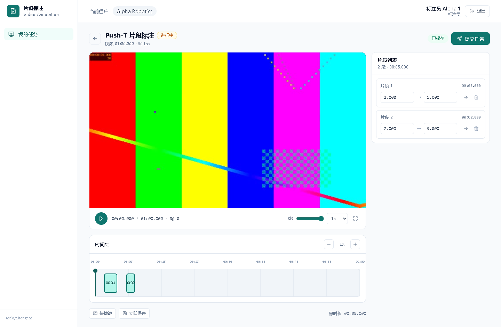
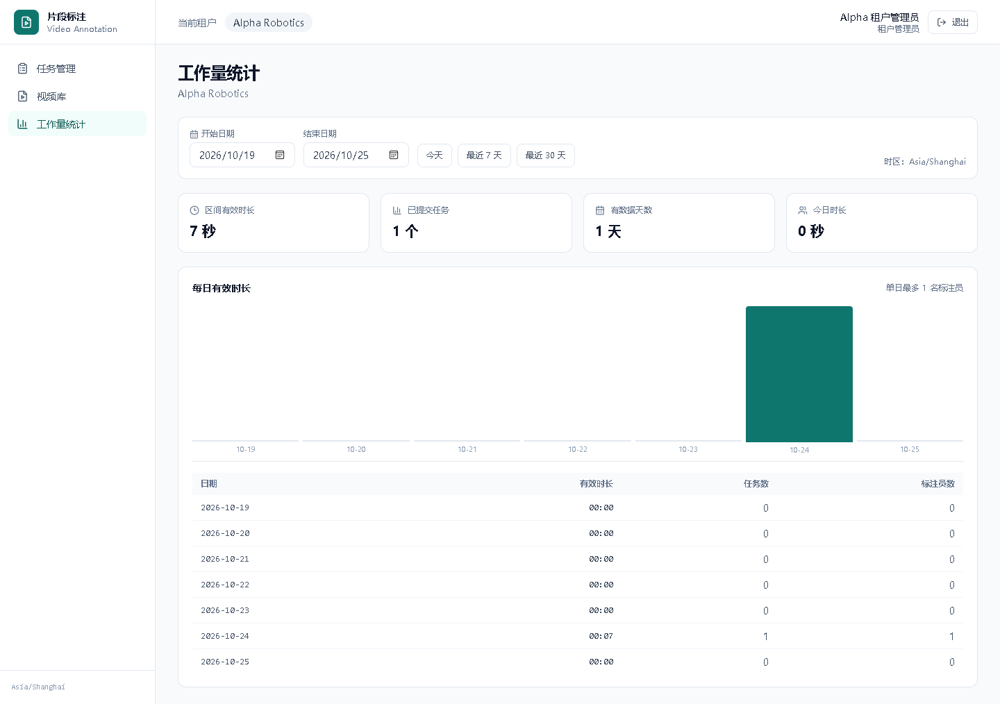

# 视频片段标注平台

多租户 Web 应用：管理员发布视频标注任务，标注员领取任务并在视频上标出时间段，管理员按提交日查看有效工作量。

## 功能

- 三种角色：平台管理员、租户管理员、标注员。
- 视频上传、ffprobe 探测、封面生成、HTTP Range 流式播放。
- 任务发布、一人独占领取、释放、管理员重新分配。
- 标注工作台：视频播放器、时间轴拖拽、起止时间编辑、I/K 快捷键、撤销、自动保存。
- 同一任务片段不重叠校验（前端即时提示 + 后端强制校验）。
- 提交锁定、空提交二次确认、已提交片段只读。
- 管理员每日有效时长统计：只算已提交任务，按 `Asia/Shanghai` 提交日归集。
- 后端强制租户隔离：任务、视频、统计、片段全部按 session 租户校验。
- Docker Compose 一键启动；seed 演示账号和合成演示视频。

## 截图







## 技术栈

- 前端：React + TypeScript + Vite + TanStack Query + Tailwind CSS
- 后端：Python 3.12 + FastAPI + SQLAlchemy 2.0 + Alembic
- 数据库：PostgreSQL 16
- 视频：ffmpeg / ffprobe，HTTP Range
- 测试：pytest（30 个单元/集成测试）+ Playwright（E2E）
- 部署：Docker Compose + Nginx

## 快速启动（Docker）

前置要求：Docker Desktop 已启动。

```bash
docker compose up --build
```

打开：

- 前端：<http://localhost:8080>
- 后端健康检查：<http://localhost:8000/api/health>
- OpenAPI 文档：<http://localhost:8000/docs>

首次启动会自动执行 Alembic 迁移、seed 演示数据、生成演示视频。后续启动 seed 会跳过已有数据。

国内网络如果拉取基础镜像失败，在 Docker Desktop → Settings → Docker Engine 里配置镜像加速，例如：

```json
{
  "registry-mirrors": ["https://docker.m.daocloud.io"]
}
```

后端 Dockerfile 默认使用清华 apt/pip 镜像；海外环境可以通过 build args 覆盖 `APT_MIRROR` 和 `PIP_INDEX_URL`。

停止：

```bash
docker compose down
# 彻底清空数据库
docker compose down -v
```

## 演示账号

仅用于本地演示，不要在生产使用。

| 角色 | 邮箱 | 密码 | 租户 |
|---|---|---|---|
| 平台管理员 | `platform@example.com` | `Platform123!` | 跨租户 |
| 租户管理员 | `admin.alpha@example.com` | `Admin123!` | Alpha Robotics |
| 租户管理员 | `admin.beta@example.com` | `Admin123!` | Beta Robotics |
| 标注员 | `ann.alpha1@example.com` | `Annotator123!` | Alpha Robotics |
| 标注员 | `ann.alpha2@example.com` | `Annotator123!` | Alpha Robotics |
| 标注员 | `ann.beta1@example.com` | `Annotator123!` | Beta Robotics |

登录页也提供演示账号快捷填入。

## 视频支持

seed 会用 ffmpeg 生成一段 60 秒演示视频（1280×720、30 fps、H.264），首次启动自动完成，无需外网。

上传入口支持 MP4 / WebM，单文件最大 2 GB；服务端用 ffprobe 读取时长、帧率、分辨率与编码，生成封面并做 faststart 处理。

重新生成演示视频：

```bash
python scripts/generate_demo_video.py
```

输出：`storage/videos/demo/demo.mp4`。

## 测试

后端：

```bash
cd backend
pytest -q
```

当前结果：**30 passed**。覆盖区间、时区、认证、租户隔离、并发领取、草稿、提交、统计、Range、上传探测。

前端 E2E（需要后端和前端已启动；默认连 `http://localhost:5173`，可用 `E2E_BASE_URL` 覆盖）：

```bash
cd frontend
npx playwright test
```

测试 Docker/Nginx 构建：

```powershell
$env:E2E_BASE_URL='http://127.0.0.1:8080'
npx playwright test
```

E2E 默认使用本机 Edge（`channel: "msedge"`）。功能用例会创建一个以 `E2E` 开头的任务并提交，用于验证领取/标注/提交/统计；不会改动 seed 任务。另有 1 个截图用例，只读验证页面。

Range 手工验收：

```bash
curl -I -H "Range: bytes=0-1023" http://localhost:8000/api/videos/<id>/stream
```

期望 `206 Partial Content`、`Content-Range`、`Accept-Ranges: bytes`。

## 本地开发

### 1. 启动数据库

```bash
docker compose up -d db
```

### 2. 后端

Windows PowerShell：

```powershell
cd backend
python -m venv .venv
.\.venv\Scripts\Activate.ps1
pip install -r requirements.txt
alembic upgrade head
python -m app.seed
uvicorn app.main:app --reload --port 8000
```

macOS / Linux：

```bash
cd backend
python -m venv .venv
source .venv/bin/activate
pip install -r requirements.txt
alembic upgrade head
python -m app.seed
uvicorn app.main:app --reload --port 8000
```

### 3. 前端

```bash
cd frontend
npm install
npm run dev
```

打开 <http://localhost:5173>。Vite 会把 `/api` 代理到 `http://localhost:8000`。

### 4. 环境变量

```bash
cp .env.example .env
```

本地默认值即可；Docker Compose 会用自己的环境变量覆盖数据库地址。

## 规则口径

- 片段区间是半开区间 `[start_ms, end_ms)`；首尾相接不算重叠。
- 有效时长 = 已提交 assignment 的片段长度之和；草稿、已释放、未领取不计。
- 有效时长计入 `submitted_at` 在 `Asia/Shanghai` 的那一天，不是标注日或视频内时间。
- 提交后锁定；重复提交返回 409。
- 空提交允许，但必须 `confirm_empty=true`，前端二次确认。
- 任务租户必须等于视频租户；所有查询从 session 取租户。
- 视频播放支持 Range 206/416；视频流和封面也必须鉴权。

## 目录结构

```text
video-annotation-platform/
├── backend/            FastAPI、SQLAlchemy、Alembic、pytest
├── frontend/           React、Vite、Tailwind、Playwright
├── docs/               设计文档（范围、决策、架构、API、UI、测试）
├── skills/             项目 AI skills（domain/API/租户/UX/release）
├── scripts/            演示视频生成
├── storage/            运行时视频与封面（gitignore）
├── AGENTS.md           AI 编码硬约束
└── report.md           交付报告
```

## 已知限制

- 浏览器：Chrome / Edge / Firefox；AV1 播放取决于浏览器与系统解码能力，Safari 建议使用 H.264 源。
- 上传：单文件最大 2 GB；大文件耗时取决于网络，Nginx 超时 300 s。
- 列表按 `created_at DESC` 返回，不分页。
- 时区固定为 `Asia/Shanghai`，修改配置会改变历史日归集。
- 单个任务最多 500 个片段。
- 本期不含：任务退回/重开、评论/标签、AI 自动分段、多人协作、URL 导入视频、移动端专门适配、审计日志。
- Docker 基础镜像需要能访问 Docker Hub 或配置镜像加速。

## 素材与许可

演示视频由 ffmpeg `testsrc2` 合成，不涉及第三方素材；上传视频的版权与使用许可由上传方负责。

## 文档

- [产品范围](docs/00-overview.md)
- [决策记录](docs/01-decisions.md)
- [架构设计](docs/02-architecture.md)
- [实施计划](docs/03-implementation-plan.md)
- [测试计划](docs/04-test-plan.md)
- [UI/UX 规格](docs/06-ui-spec.md)
- [API 契约](docs/07-api-contract.md)
- [设计自审](docs/08-self-review.md)
- [AI 协作与验证](docs/05-ai-collaboration.md)
- [交付报告](report.md)
